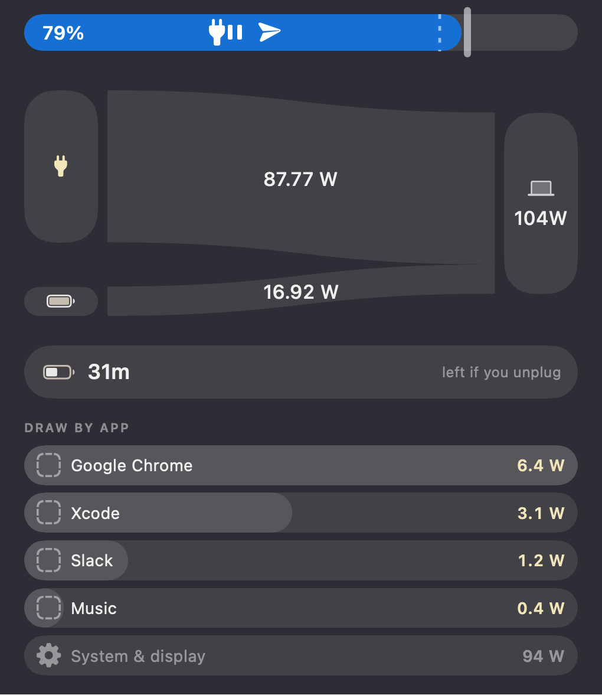
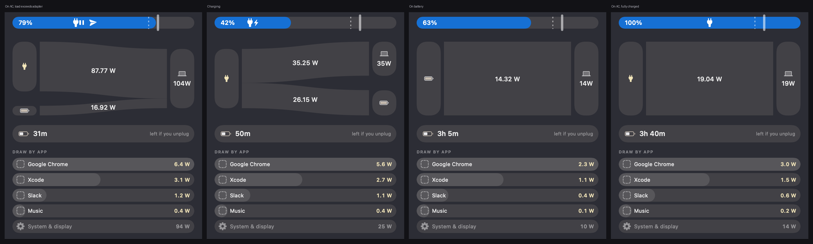
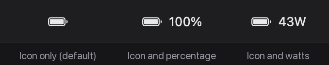

# PowerFlow

[](https://github.com/dylansantwani/powerflow/actions/workflows/ci.yml)

Live power-flow monitor for the macOS menu bar. It shows what the adapter is
delivering, what the battery is giving or taking and what the machine is
actually burning — as a Sankey diagram whose ribbon thicknesses *are* the
wattages — then how long you would last if you unplugged right now, and which
apps are spending it.



Node heights and ribbon thicknesses share one watts-to-points scale, so the
picture is quantitative rather than decorative: the machine's card is exactly as
tall as the two ribbons feeding it, stacked, and the two ribbon labels add up to
the number on it.

## Features

- **Live power flow.** Adapter in, battery in or out, and system load, read from
  SMC sensors that update about once a second. The three always balance.
- **Runtime if you unplug.** Remaining pack energy over the averaged load —
  the same question whether or not a cable is attached.
- **Draw by app.** Per-app wattage from the kernel's own energy accounting, with
  helper processes folded into the app that spawned them, and everything not
  attributable to an app shown honestly as a system remainder.
- **Charge markers.** A draggable target and floor that tell you when your
  charge crosses them. They do *not* change how the Mac charges — see below.
- **Menu bar or hotkey.** ⌥⌘P opens the panel even when the menu bar is too
  full to show the icon.

The diagram adapts to what the battery is doing: a source while discharging, a
sink while charging, absent when idle.



## Requirements

- macOS 14 or later
- Apple silicon for live wattage. Intel Macs fall back to the slower
  IORegistry figures, which still work but refresh about once a minute.
- Xcode command line tools to build. `scripts/make-icon.py` needs Pillow; the
  build skips the icon if it is missing.

Everything is read-only and local: the app opens the SMC user client for
reading, never writes a key, and makes no network connections.

On a Mac with no battery the panel says so rather than drawing an empty frame.
On wake the SMC connection is re-opened and the smoothing, load average and
per-app baselines are all discarded, because every one of them describes a
machine that was asleep.

## Install

```bash
./build.sh install
```

Builds, bundles, ad-hoc signs and copies to `~/Applications/PowerFlow.app`, then
launches it. It appears in the menu bar only — no Dock tile.

Left-click the menu-bar item to open the panel, or press **⌥⌘P** from
anywhere. Right-click for adapter, health, cycle count, temperature, what the
menu-bar item shows, **Launch at Login**, and Quit.



The item defaults to the icon alone. A crowded menu bar fills from the right
edge leftward and pushes anything that does not fit past the notch, so the
narrowest form is the one most likely to be visible; the percentage and wattage
variants are in the right-click menu.

### If it does not appear in the menu bar

Almost always because the menu bar is full, not because the app failed. macOS
lays status items out from the right edge leftward; when that row is full the
next item is pushed past the notch into the app-menu area, where the frontmost
app's menus cover it. It is running and clickable, just nowhere you can see.

Measured on a 14" MacBook Pro whose bar was already full: the item landed at
x 665–704, entirely inside the notch (663–848). Shrinking it to icon-only
(39pt instead of 83pt) did not help, because the next free slot *is* the notch.

- **Press ⌥⌘P.** The panel opens anchored to the top right of the screen
  whether or not the item can be seen.
- **Free about 40pt.** Quit one menu-bar app, or set a couple of Control Center
  modules (Bluetooth, Sound, Screen Mirroring, Stage Manager, Now Playing) to
  "Don't Show in Menu Bar" in System Settings › Control Center. PowerFlow
  appears immediately.
- **⌘-drag** menu-bar items to reorder them once it is visible.
- A menu-bar manager such as Ice, Bartender or Hidden Bar solves it permanently.

`--diagnose` prints where the item actually landed, the notch bounds and whether
the hotkey registered.

## Where the numbers come from

Three sources, each used for what it is actually good at:

| Source | Used for | Refresh |
| --- | --- | --- |
| **SMC** (`PDTR`, `B0AC`, `B0AV`) | adapter watts, battery current and voltage | ~1 s |
| **IOPowerSources** | charge %, cable state, charging, time remaining | on change |
| **`AppleSmartBattery`** | health, cycles, temperature, adapter identity, pack capacity | ~60 s |
| **`proc_pid_rusage`** | per-process energy for the app list | 3 s |

The obvious approach — read `AppleSmartBattery`'s `PowerTelemetryData` — turns
out to republish only about **once a minute**, which is useless for a live
diagram. The SMC exposes the same quantities as sensors that update every
second, so that is what the app runs on. `AppleSmartBattery` is still read for
the slow-moving facts, where a minute of staleness costs nothing.

### Runtime remaining

`remaining Wh / system load`, where the load is the machine's own consumption
and therefore excludes any power going into charging. That makes the answer
independent of whether a cable is currently attached.

Capacity in mAh needs a voltage to become watt-hours, and it must be the
**nominal** voltage, not the instantaneous one: a full pack reads about 13.2 V
but averages roughly 3.8 V per cell across a discharge, so using the full-charge
figure overstates runtime by about 15%. Cell count comes from the pack itself.
On this machine that yields 71.2 Wh design capacity, against Apple's published
70 Wh — the right answer.

The load is averaged over 60 s. An estimate computed from an instantaneous
reading swings between one hour and five as the load spikes.

### Draw by app

Per-app power comes from `ri_energy_nj` in `rusage_info_v6` — the kernel's own
cumulative energy attribution per process, in nanojoules. Sampling it twice and
dividing by the interval gives watts. It needs no root for processes you own,
which is every app you actually run; root-owned daemons are skipped rather than
guessed at. Helper processes are folded into the app that spawned them by
walking the parent chain, so a browser's twenty renderers are one row.

**What the numbers mean.** `ri_energy_nj` accounts for CPU energy, not the whole
machine. Measured here under a controlled load — eight busy processes — the
system rose 20.8 W while attributed app energy rose 9.8 W, so it tracks real
power closely but captures roughly half of it: the rest is the SoC overhead,
memory and regulator losses that a higher clock induces but which are not billed
to any one task. At idle the apps account for 10–25% of system draw.

So the list does not pretend apps sum to the wall figure. Whatever is not
attributable to an app is shown as a **System & display** row, and it is usually
the largest number on screen.

**That row is not an idle figure**, which is the easiest thing to misread about
it. WindowServer is the clearest case: it runs as `_windowserver`, so
`proc_pid_rusage` is denied for it and its energy cannot be read at all — let
alone charged to the app whose drawing keeps it busy. Measured on this machine
it was using 52% of a core while the whole app list totalled 2.6 W against a
31 W system load. The row also carries the display, the GPU, every other
root-owned daemon, and the roughly half of app power that `ri_energy_nj` does
not bill. A machine reading 30 W here is working, not resting.

The bars compare apps only with each other, since letting the remainder set the
scale would flatten them all to nothing.

Apple does not publish true per-app watts — Activity Monitor shows a unitless
"Energy Impact" for exactly this reason. These are real measurements of a real
quantity, labelled for what they are.

**The system load is derived, never read as a third sensor.** `PDTR` and `PSTR`
are sampled on different schedules and disagree by several watts moment to
moment; a Sankey whose ribbons do not add up to the node they feed is simply
wrong. So the app reads the adapter and the battery, and computes:

```
systemLoad = adapterPower - batteryPower        (battery positive = charging)
```

which is the same identity Apple's own telemetry satisfies, and the same one the
reference screenshot's numbers obey exactly: `87.77 - (-16.92) = 104.69`.

Everything is read-only. The app opens the SMC user client for reading and never
writes a key. It makes no network connections.

## The two markers on the pill

The handle and the dashed line are **charge markers**, not a charge limiter.

macOS exposes no public API for capping charge; apps that enforce a limit write
SMC registers through a privileged root helper installed with admin rights.
PowerFlow deliberately does not do that — it does not change how your Mac
charges. Drag the handle to set a target and the dashed line to set a floor;
the panel shows your charge against them and notifies you when one is crossed.
Notification permission is requested the first time you actually move a marker,
so if you never touch them you are never asked.

## Development

The layout was reproduced from a reference design supplied as a screenshot. Every
constant in [`Spec.swift`](Sources/PowerFlow/Spec.swift) is expressed in that
image's pixels and scaled once, so each one can be checked against the original
and the proportions hold at any panel size. Where this file says "the reference",
that is what it means.

```bash
swift test                                  # 28 tests, no hardware needed
./build.sh                                  # bundle without installing

.build/release/PowerFlow --probe            # current reading, balance check, runtime
.build/release/PowerFlow --smc              # raw sensor sampling, 10 ticks
.build/release/PowerFlow --apps             # per-app watts vs system total
.build/release/PowerFlow --diagnose         # status item placement, notch, hotkey
.build/release/PowerFlow --stability        # 60 samples, flags impossible readings
.build/release/PowerFlow --animtest dir/    # frame-by-frame animation measurement
.build/release/PowerFlow --sensorrate      # how often the SMC actually changes
.build/release/PowerFlow --render-menubar dir/   # the status item, each style
.build/release/PowerFlow --selftest out.png # opens the real popover, captures its pixels
.build/release/PowerFlow --render out.png --width 340 --scale 3.7235 --live
.build/release/PowerFlow --render out.png --state charging|battery|full|sample
.build/release/PowerFlow --render out.png --reference-only   # just the 1:1 region
```

`--render` draws the panel offscreen, which is how the layout was checked
against the reference: `--reference-only` renders just the part that mirrors the
screenshot, at its exact pixel width, so feature bounding boxes can be compared
and the 1:1 match stays regression tested as the panel grows. Render at the app's real point size and scale
the image up — rendering at a large point size silently swaps SF Pro's optical
variant from Text to Display and narrows the type.

### Motion

Three things made the panel look jerky, all fixed:

1. **The ribbons could not animate at all.** They were drawn as `Path(...)`,
   which is a static view — SwiftUI has no way to interpolate between two of
   them. So the ribbons snapped to each new reading while the node cards beside
   them glided, and the mismatch read as stutter. `RibbonShape` is a real
   `Shape` whose four edge positions are exposed as `animatableData`, so the
   geometry is tweened per frame.
2. **The curve fought the sampling rate.** An `easeInOut` of 0.45 s against 1 s
   sampling animated briefly and then sat still, and restarting an ease-*in*
   from an already-moving state breaks velocity at every sample. Motion is now
   a critically damped spring: it starts fast, decelerates into rest, and blends
   its velocity when a new reading interrupts it.
3. **Numbers snapped and rows swapped.** Wattages use
   `.contentTransition(.numericText())` so digits roll, and per-app watts are
   smoothed before sorting, which stops rows trading places every few seconds.

`dampingFraction` is exactly 1. Anything less overshoots, and a ribbon that
springs past its wattage before settling back is drawing a reading the machine
never had.

The sensors only change about **1.1 times a second** (measured with
`--sensorrate`: mean 939 ms between changes, never faster than 623 ms), so
there is no more detail to be had by animating for longer — a slow curve just
delays the number. The spring settles well inside that gap:

| | old (linear 1.2 s) | now (spring, response 0.42) |
| --- | --- | --- |
| 50% of the change | 616 ms | **125 ms** |
| 90% | 1091 ms | **275 ms** |
| fully settled | 1199 ms | **467 ms** |
| overshoot | none | none |

Measured with `--animtest`, which records the value SwiftUI hands the view on
every animation frame — 130 frames at a mean 8.2 ms gap, i.e. 121 fps with no
dropped frames.

**Nothing is published to the panel while it is closed.** An earlier version
animated for longer than the gap between readings, so a new animation began
before the last ended and the view never settled; left running behind a closed
popover that was a permanent 120 fps render loop measuring 21–34% of a core.
Absurd in an app whose job is watching power, and it inflated the very number on
screen. It is now a fraction of a percent closed. The first publish on opening
is wrapped in a transaction with animations disabled, so the panel does not
lurch from a stale reading to the current one each time it appears.

Note that pixel capture cannot verify any of this: `cacheDisplay` renders the
model layer, not the presentation layer, so a screenshot taken mid-animation
shows the final state. Recording `animatableData` is the way to see it.

The Sankey labels deliberately do **not** use `.monospacedDigit()`. It stops
width jitter, but it widened them past the reference; SF Pro's proportional
figures barely vary, and the numeric transition already smooths the change. The
per-app rows, which are not part of the reference, do use it.

### Layout

`SankeyLayout` is pure geometry with no UI dependencies, so the reference
measurements are asserted directly in tests:

- Node heights and ribbon thicknesses share one watts-to-points scale.
- The busier column fills the height once inter-node padding is subtracted;
  that is what fixes the scale. The other column is centred on the same axis.
- The battery moves between columns: a source while discharging, a sink while
  charging, absent when idle.
- Ribbons leave each node top-down so they never cross.

### Layout of the source

```
Sources/PowerFlowKit/     no UI, fully tested
  PowerSnapshot.swift     one instant of power state, plus sample states
  SMCReader.swift         read-only AppleSMC user client
  PowerReader.swift       composes SMC + IOPowerSources + AppleSmartBattery
  SmartBatteryReader.swift IORegistry parsing and flow reconciliation
  SankeyLayout.swift      the diagram's geometry
  RibbonShape.swift       the animatable ribbon, and shared motion timing
  AppEnergySampler.swift  per-process energy, folded into per-app watts
  RuntimeEstimate.swift   runtime left, and the rolling load average
  SampleGuard.swift       rejects readings that cannot be true
  Format.swift            "87.77 W" on ribbons, "104W" on the machine's card
Sources/PowerFlow/        the app
  Spec.swift              every measured constant, in reference pixels
  BatteryPillView.swift   pill, status glyphs, draggable markers
  SankeyView.swift        nodes, ribbons, labels
  AppDrawView.swift       runtime card and the per-app rows
  RunningApps.swift       pid to application name and icon
  PanelView.swift         the popover
  Settings.swift          markers, notifications, launch at login, label style
  Hotkey.swift            global ⌥⌘P, and the off-screen popover anchor
  App.swift               status item, popover, render/probe modes
```

## Known deviations from the reference

- **Glyph outlines.** The reference was built against an older SF Symbols set —
  its plug is the pre-SF-5 vertical `powerplug.fill` with a thin cord, and its
  paper plane is narrower. PowerFlow uses the current system symbols at matched
  sizes and positions, so it looks native on a current macOS rather than dated.
- **Text width** differs by 3–5% at identical cap heights, which is font
  rendering, not layout. Sub-pixel at the panel's real size.
- The screenshot is cropped ~6px off-centre; PowerFlow uses symmetric padding.

## License

MIT — see [LICENSE](LICENSE).
